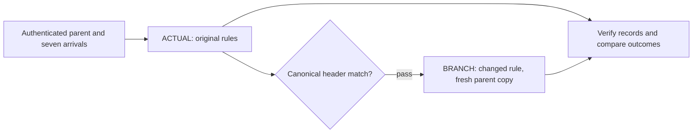

# RHOOK

[](https://github.com/USBVadik/rhook/actions/workflows/ci.yml)

**A Counterfactual Execution protocol for Arbitrum-based chains.**

RHOOK replays historical execution, changes one supported rule, and compares
what happens. The original execution must match the canonical chain before an
alternative world can run from its own copy of the original state.

Hookr is the first supported application. Our working example is a pool on
Robinhood Chain: replay all seven arrivals
in block **93251803**, change LP Rewards from **100 to 50**, then verify the new
receipts and compare the buyer's output. The Python API and CLI follow:

```text
inspect → plan → authorize → replay → verify → compare
```

[Read the Hookr result](docs/research/hookr-pair03-100-to-50.md) ·
[Developer SDK](sdk/README.md)

**Executable download is pending.** The public clone contains source and offline
tests. The private executable pilot has passed clean installation and native
replay on the development Mac; its worker, runtimes and Pair03 witness are not
published here.

Try the public SDK tests with Python 3.12+:

```sh
python3 -B sdk/tools/test_offline.py
```

## Historical execution SDK source

The source now includes the portable `CaseSDK`, the maintained historical
workflow and a closed [intervention catalogue](sdk/INTERVENTION_ADMISSION.md).
It supports the pinned LP Rewards adapter and historical Dynamic Fee OFF adapter;
it does not expose arbitrary state writes or arbitrary-pool execution.

```sh
python3 -B sdk/install_cases.py --prefix /physical/path/to/new-sdk
/physical/path/to/new-sdk/bin/rhook-cases --home /physical/path/to/new-home interventions
/physical/path/to/new-sdk/bin/rhook-cases --home /physical/path/to/new-home execution-capabilities
```

These source-only commands do not run native code or grant execution authority.
Missing worker, runtime, chain dependencies and prepared witness are reported
explicitly. Read the [historical workflow](sdk/HISTORICAL_EXECUTION.md),
[prepared scenario API](sdk/DEVELOPER_EXECUTION.md) and
[source-sync boundary](sdk/SOURCE_SYNC.md).

The [clean-room guide](sdk/CLEAN_ROOM.md) covers installation with a pinned
317-file source inventory and explicit missing-runtime diagnostics. Installation,
case import and planning do not require a private worker. Native replay still
requires separately supplied, matching runtime and authenticated case data.

## The question we test

If a DeFi rule had been different, would the same transactions have produced a
different result? RHOOK makes that question explicit: fix the parent state and
ordered input, declare one intervention, execute both worlds, and inspect the
consequences. It is intended for developers investigating contract and hook
behavior against authenticated blockchain state.

The historical ACTUAL is a control. In the Hookr case, its stateRoot,
receiptsRoot and blockHash must all match the canonical target header before
BRANCH begins. BRANCH uses a fresh copy of the original parent, rather than
ACTUAL's end state. Missing state stops the run; replay does not fetch more data.



## What has run

| Demonstration | Result and scope |
| --- | --- |
| Historical Hookr LP100→50 | Both Go/Nitro worlds completed. Buyer RHOOK Transfer-event net increased by **0.5040100829%**; subject gas was unchanged. [Case study](docs/research/hookr-pair03-100-to-50.md). |
| Mac/Linux execution agreement | A separate Ubuntu amd64 worker reproduced the complete macOS results for this case. This is portability within the same engine lineage. |
| Installed Developer Alpha | On 25 October 2026, a separately built macOS developer worker completed a new pair through an installed CLI. Its own `verify` and `compare` passed; full world files matched the prior references. Installed replay took **6.05 seconds** on that Mac. |
| Historical Dynamic Fee OFF (Build18) | The signed 0.01 ETH purchase in block 93251803 remained SUCCESS in both Go/Nitro worlds, with LP100 and recapture retained. This is a separate intervention from LP100→50; [scope and assurance](sdk/SOURCE_SYNC.md). |
| Private recorder-only replay (Build26D / Build27g) | Two historical cases completed fresh ACTUAL/BRANCH pairs using recorded dependencies without access to their full references during replay. Same Go/Nitro lineage; [results and limits](sdk/RECORDER_RESULTS.md). |
| Public developer surface | Python API, CLI, Hookr inspect/plan adapter and synthetic offline tests are published. Independent external-developer installation is the next test. |

The intervention reduces the LP Rewards add-on and its associated protocol share;
the Hook Block, base/dynamic fees and recapture remain enabled. Outer Swap fee
changed from 11048 to 7048 pips. These are observations for one historical trade,
not a forecast of profit. The [earlier LP100→0 result](docs/research/hookr-pair03.md)
is a different branch and must not be confused with this demonstration.

This Hookr case has no independent Rust execution, economic assurance remains
unresolved, and qualified protocol Claims are zero. Arbitrary pools, rules and
historical blocks remain outside the supported Alpha case.

## Use the repository

The [SDK quickstart](sdk/QUICKSTART.md) separates public offline tests from private
pilot installation. A clone alone cannot perform a fresh native Pair03 replay.
The [compatibility table](sdk/COMPATIBILITY.md) lists the supported platform and
case. The [distribution status](sdk/DISTRIBUTION.md) explains what is withheld.

The protocol-neutral evidence stack also has a small runnable example. With
Node.js 22+:

```sh
npm ci
npm run check
npm test
npm run quickstart
```

This [quickstart](QUICKSTART.md) generates and checks a synthetic transcript,
including a deliberate tamper rejection. It does not run Hookr or an EVM.
Neither command sequence needs a provider account or starts native execution.

## Next milestones

1. **Historical replay: working.** The installed private Alpha reproduces the
   accepted Hookr case from retained inputs and checks its new evidence.
2. **First external developer: next.** One supported Mac, one install and native
   LP100→50 replay, then feedback on whether the SDK is useful and understandable.
3. **Hookr LaunchLab: in development.** Let developers choose supported hook
   settings against authenticated state. A bounded on-demand scenario completed
   privately; general acquisition and public hosted execution remain open.

Robinhood Chain is the current execution target. The broader direction is a
reusable testing tool for DeFi developers on Arbitrum-based chains. We are
looking for developers who want to test the fixed Alpha case and help choose
which real debugging questions the next adapters should answer.

## Research and contributing

The [research index](docs/research/README.md) separates the SDK's Hookr result
from earlier experiments, including Go/Nitro and Rust/arb-revm agreement on
other Robinhood cases. Those results do not qualify Hookr Pair03 on Rust.
See the [model](docs/counterfactual-model.md), [architecture](docs/architecture.md)
and [threat model](docs/threat-model.md) for protocol details.

The [Robinhood v4 example](examples/robinhood-v4/README.md) retains an explicit
Docker native command; ordinary tests never start it. The separate
[Alchemix study](examples/alchemix/README.md) has not been scientifically rerun on Alchemix
by the protocol-neutral stack.

Read [CONTRIBUTING.md](CONTRIBUTING.md). Original RHOOK code and documentation use
[Apache-2.0](LICENSE); the [SDK license scope](sdk/LICENSE_SCOPE.md) and
[third-party notices](THIRD_PARTY_NOTICES.md) preserve upstream terms. The source
license does not clear the combined executable or historical witness for release.
